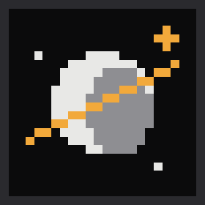
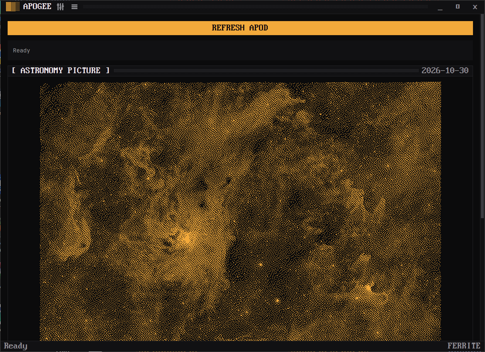

<p align="center">
  
</p>

<h1 align="center">Apogee</h1>

<p align="center">
  NASA's Astronomy Picture of the Day in Ferrite dither.
</p>

<p align="center">
  <a href="https://github.com/rwetz/ferrite-apogee/actions/workflows/ci.yml"></a>
  <a href="https://github.com/rwetz/ferrite-apogee/releases/latest"></a>
  <a href="LICENSE"></a>
</p>



An early development release. [Windows downloads](https://github.com/rwetz/ferrite-apogee/releases/latest) are also installable through Lodestone.

## Run

Requires Rust 1.92 or later and the normal GPUI native toolchain. Ferrite Design
is pinned to a published GitHub commit and fetched automatically by Cargo.

```powershell
git clone https://github.com/rwetz/ferrite-apogee.git
cd ferrite-apogee
cargo run
```

NASA's public APOD feed is key-free. Apogee requests today's metadata directly
from `science.nasa.gov`, then downloads the actual image URL for its preview.

## Current slice

- Fetch today's APOD title, date, credit, explanation, and media URL.
- Download and dither image entries with bounded download/decode limits.
- Recognize video entries and provide a browser link.
- Show bounded loading and useful errors without blocking the window.

The title-bar menu and Ctrl+Shift+P expose actions and scheme/appearance changes.
`FERRITE_SCHEME`, `FERRITE_APPEARANCE`, and `FERRITE_FPS` supply launch defaults.
These scaffolds do not yet persist their own theme or use the planned shared settings store.

## Next

Date browsing, local cache, ASCII mode, export, and a Darkroom handoff.
Video entries are opened externally. The preview is deliberately bounded and is not a full-resolution export.

## API reference

[Current NASA API documentation](https://api.nasa.gov/)

## Validation

```powershell
cargo check
cargo clippy -- -D warnings
cargo test
cargo run -- --smoke           # verify the real service without opening a window
```

Compilation and service tests do not establish native window, scrolling, or device quality.

## Automatic releases

Every push to `main` runs the release workflow. It chooses the next available
patch version (or honors a higher version set in `Cargo.toml`), creates a release
commit with matching `Cargo.toml` and `Cargo.lock` versions, and tags that commit.
Release commits stay off `main`, so the workflow cannot create a push loop.
Builds and tests must succeed before publication. Rerunning a workflow reuses
its tag. Manual `vMAJOR.MINOR.PATCH` tags still work when they match the package
version. Push feature branches normally; they do not publish releases.

Each Windows executable includes its own pixel icon. `assets/logo.svg` also
supplies the matching catalogue icon in Lodestone.

## Settings

Open the sliders button in the title bar, press Ctrl+, or choose Settings from the command palette. All ten schemes, Dark/Light/System appearance, motion refresh rate (12 to 240 FPS), and row density apply immediately and persist per app. Save failures appear in Settings. Start with `--settings` to open the drawer directly. Ferrite launcher environment overrides take precedence at startup.

## Keys

| Keys | |
|---|---|
| <kbd>Ctrl</kbd>+<kbd>Shift</kbd>+<kbd>P</kbd> | Command palette |
| <kbd>Ctrl</kbd>+<kbd>,</kbd> | Settings |

---

<p align="center">
  <picture>
    <source media="(prefers-color-scheme: dark)" srcset="docs/brand/heptagram-white.svg">
    
  </picture>
</p>
